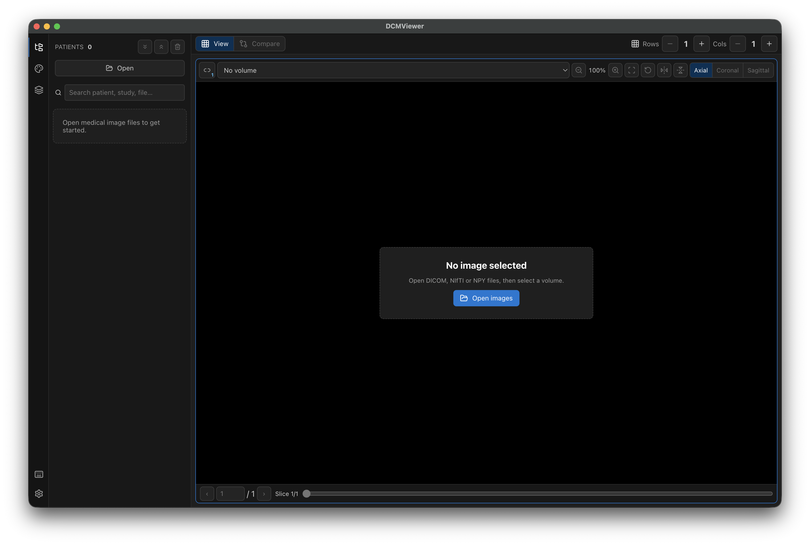
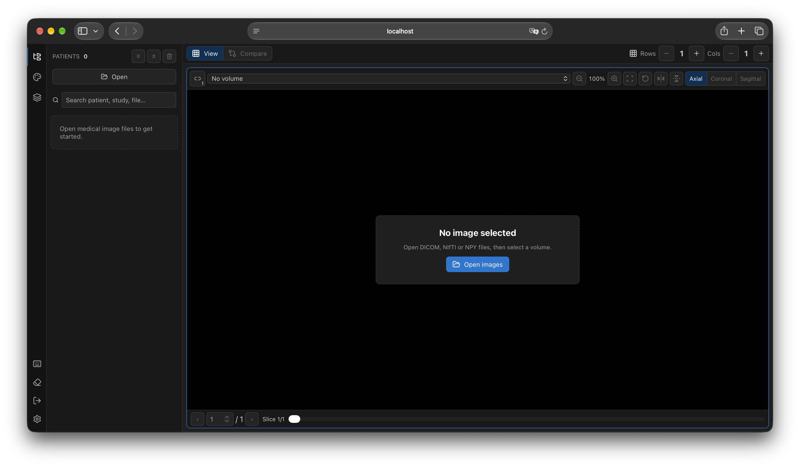
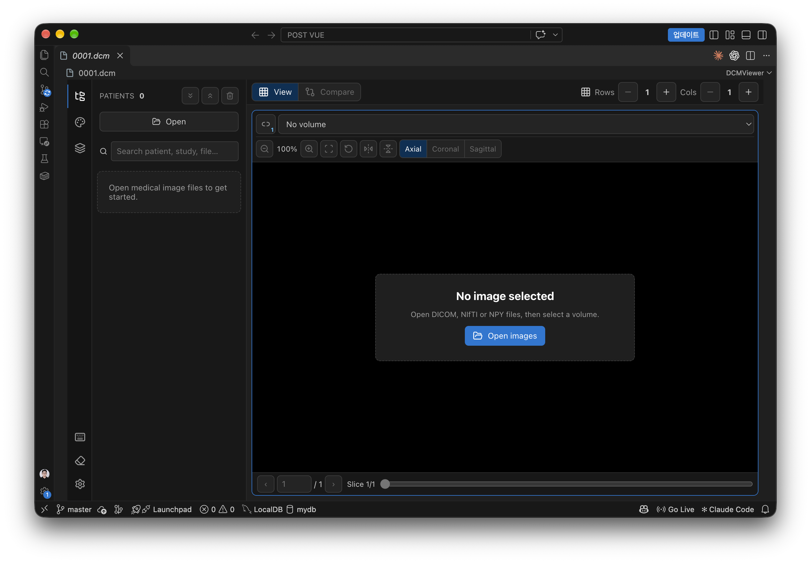
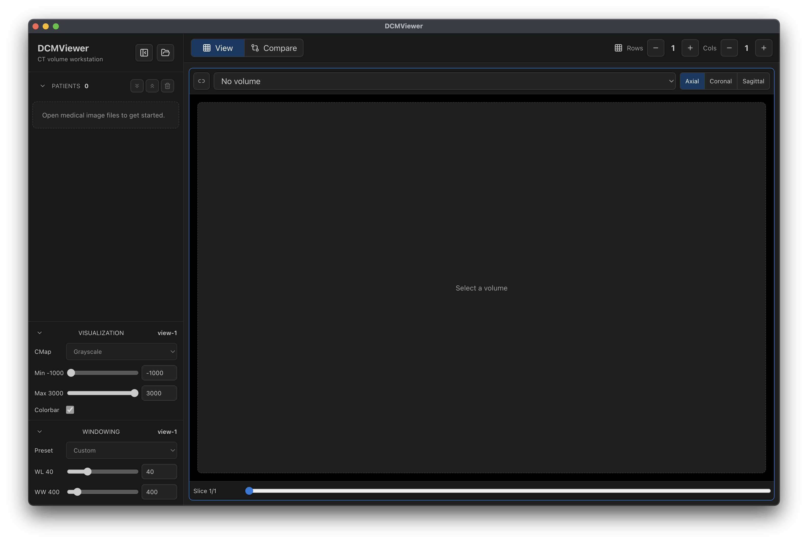
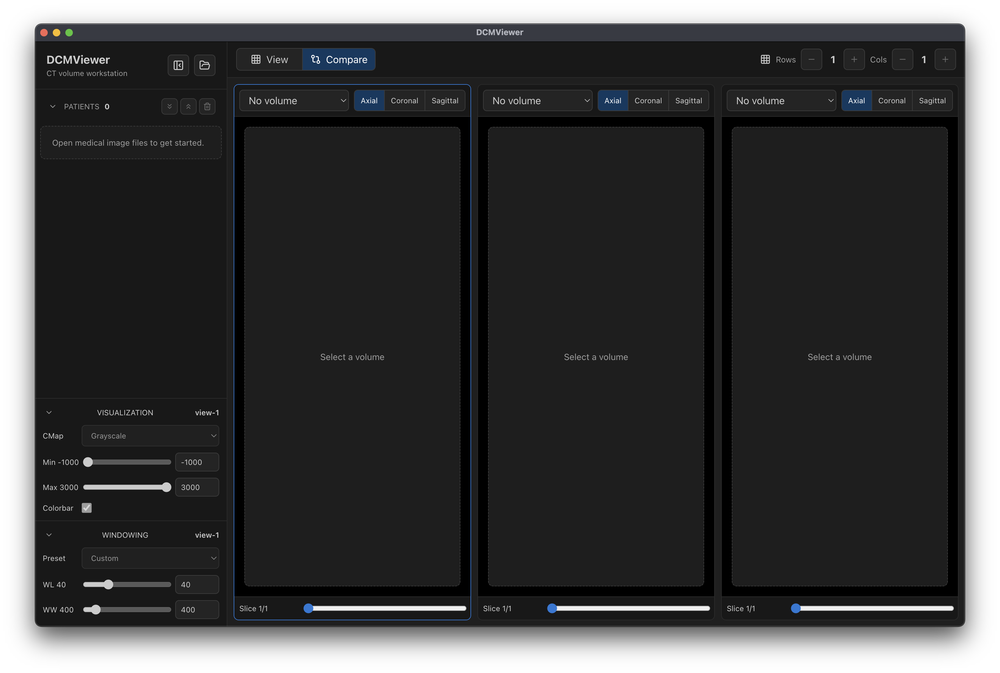

<p align="center">
  
</p>

# DCMViewer

DCMViewer는 DICOM 시리즈, NIfTI, NumPy 볼륨을 슬라이스 단위로 탐색하고 여러 영상을 비교하는 읽기 전용 의료 영상 뷰어입니다. Electron 데스크톱 앱과 VS Code 확장 프로그램이 동일한 React 렌더러를 사용하며, 라벨 오버레이와 원격 작업 공간의 단면 로딩을 지원합니다.

현재 소스 버전은 **2.0.7**입니다. 실제 실행 화면은 아래 스크린샷에서 확인할 수 있습니다.

## 주요 기능

| 기능 | 지원 내용 |
| --- | --- |
| 볼륨 로딩 | 파일·폴더 선택, 하위 폴더 탐색, DICOM 시리즈 구성, 다채널 NPY 분리 |
| 영상 탐색 | Axial / Coronal / Sagittal 전환, 슬라이스 이동, 복셀 좌표·값 확인 |
| 표시 조절 | WL/WW, 윈도우 프리셋·자동 대비, 값 범위 조절, 컬러맵·컬러바·색상 반전 |
| 화면 조작 | 25–800% 확대, 이동, 좌우·상하 플립, 화면 맞춤, 뷰 초기화 |
| 멀티뷰 | Rows / Cols로 최대 4×4 그리드 구성, 뷰포트 연결, 단일 뷰 전환 |
| 케이스 비교 | Case 1, Case 2, Case 2 − Case 1 차이 영상의 3개 뷰 |
| 라벨 오버레이 | 마스크 선택, 투명도 프리셋, Fill / Outline, 클래스 검색·단일 클래스 표시 |
| 파일·메타데이터 탐색 | 환자·Study 트리, 볼륨 검색, DICOM 메타데이터 검색, 볼륨 제거 |
| 원격 VS Code | 원격 호스트에서 볼륨 해석, 필요한 단면 전송, 선읽기·로컬 캐시 |

## 빠른 시작

소스에서 실행하려면 Node.js와 npm이 필요합니다. VS Code 확장 빌드·패키징에는 **Node.js 22 이상을 권장**하며, 확장 실행에는 **VS Code 1.85 이상**이 필요합니다. 아래 명령은 저장소 루트에서 실행합니다.

### Electron 데스크톱 앱

```bash
npm ci
npm run dev
```

Vite 개발 서버가 `http://127.0.0.1:5173/`에서 실행되고 Electron 창이 열립니다. 앱의 **Patients** 패널에 있는 **Open** 버튼에서 파일 또는 폴더를 선택하세요. DICOM 전체 시리즈를 보려면 시리즈가 들어 있는 폴더를 선택합니다.

### VS Code 확장 프로그램

```bash
npm ci
npm ci --prefix vscode-extension
npm run package:vscode
```

생성된 `release/dcmviewer-2.0.7.vsix`를 VS Code의 **Extensions → … → Install from VSIX…**로 설치합니다. `package:vscode`는 확장 호스트와 웹뷰 빌드도 함께 실행합니다.

- `.dcm`, `.dicom`, `.nii`, `.nii.gz`, `.npy` 파일을 클릭해 뷰어를 엽니다. 다른 편집기가 열리면 **Open With… → DCMViewer**를 선택합니다.
- DICOM 시리즈 폴더를 우클릭하고 **DCMViewer: Open Medical Folder / DICOM Series**를 실행합니다. 파일 하나를 열면 해당 파일만 로드합니다.
- 명령 팔레트에서 **DCMViewer: Open Viewer**, **Open Medical Files**, **Open Medical Folder / DICOM Series**를 사용할 수 있습니다.
- SSH·컨테이너 작업 공간에서는 원격 확장 호스트가 접근할 수 있는 파일을 선택합니다. 브라우저 전용 VS Code는 지원하지 않습니다.

확장 개발과 원격 동작의 상세 설명은 [VS Code 확장 README](./vscode-extension/README.md)를 참고하세요.

### 웹 플랫폼 (서버 구동)

서버의 CT 볼륨을 브라우저에서 조회합니다. 볼륨은 서버에서 해석하고 필요한 단면만 전송하며, 로그인한 사용자만 접근할 수 있습니다.

```bash
npm ci
npm run build:web
npm run start:web                     # 샘플 볼륨으로 실행, http://<서버 IP>:8080
DATA_ROOT=/srv/ct npm run start:web   # 실제 데이터 디렉터리로 실행
```

`start:web`은 `platform/data/sample-phantom/`이 없으면 합성 CT 팬텀(128×128×64, HU)을 먼저 만듭니다. 같은 볼륨이 DICOM 시리즈(`dicom/*.dcm`), `phantom.npy`, `phantom.nii`, `phantom.nii.gz`와 라벨 마스크 `phantom_label.nii.gz`(1 간, 2 종양, 3 폐)로 저장됩니다. 다시 만들려면 `npm run samples:web -- --force`를 실행하세요. 생성된 볼륨과 의료 영상 확장자(`.dcm`, `.dicom`, `.nii`, `.nii.gz`, `.npy`)는 git에서 제외됩니다.

#### 계정과 관리자

- 첫 실행 시 기본 관리자 계정 **`admin` / `admin`**이 만들어집니다. 처음 로그인하면 비밀번호 변경 화면으로 이동하며, 바꾸기 전에는 다른 기능을 쓸 수 없습니다.
- 회원가입한 계정은 **승인 대기** 상태가 되고, 관리자가 승인해야 로그인할 수 있습니다.
- 관리자 계정은 영상 뷰어 대신 관리 페이지(`/admin`)로 이동합니다. 가입 승인·거절, 사용자 비활성화·활성화·삭제, 회원가입 허용과 초대 코드, 데이터 디렉터리 변경, 관리 페이지 테마를 설정할 수 있습니다. 비활성화하거나 삭제한 계정의 세션은 즉시 종료됩니다.
- 관리자 설정은 `STATE_DIR/settings.json`에 저장되며 환경 변수보다 우선합니다. 승인 기능 이전에 만든 계정은 승인된 사용자로 유지됩니다.

| 환경 변수 | 기본값 | 설명 |
| --- | --- | --- |
| `DATA_ROOT` | `platform/data` | 조회할 볼륨이 있는 디렉터리. 이 밖의 경로는 거부합니다. 관리 페이지에서 바꾸면 그 값이 우선합니다. |
| `HOST` / `PORT` | `0.0.0.0` / `8080` | 수신 주소. 로컬 전용은 `HOST=127.0.0.1` |
| `STATE_DIR` | `platform/state` | 계정(`users.json`, scrypt 해시)과 관리자 설정(`settings.json`) 저장 위치 |
| `INVITE_CODE` | 없음 | 초대 코드의 초깃값. 이후에는 관리 페이지에서 바꿉니다. |
| `VOLUME_MEMORY_MIB` | `2048` | 해석된 볼륨 메모리 상한. 넘으면 오래된 볼륨부터 해제합니다. |
| `TLS_CERT` / `TLS_KEY` | 없음 | PEM 인증서·개인키 경로. 둘 다 설정하면 HTTPS로 실행하고 `Secure` 쿠키와 HSTS를 적용합니다. |
| `COOKIE_SECURE` | 없음 | `1`이면 세션 쿠키에 `Secure`를 붙입니다(HTTPS 프록시 뒤에서 실행할 때). |

외부에 공개할 때는 반드시 HTTPS를 사용하세요. `TLS_CERT=/etc/letsencrypt/live/<도메인>/fullchain.pem TLS_KEY=/etc/letsencrypt/live/<도메인>/privkey.pem PORT=443`처럼 서버에서 직접 켜거나, HTTPS 리버스 프록시(nginx 등) 뒤에서 실행합니다. 인증서는 시작할 때 한 번 읽으므로 갱신 후에는 서버를 재시작하세요. 세션은 메모리에 저장되므로 서버를 재시작하면 다시 로그인해야 합니다. 개발 중에는 서버를 띄운 상태에서 `npm run dev:web`으로 핫 리로드 화면을 사용할 수 있고, `npm run test:web`이 관리자 최초 로그인·가입 승인·권한 분리·경로 검사·단면 전송을 검증합니다.

## 실행 화면

### 데스크톱 앱



### 웹 플랫폼



### VS Code 확장



<details>
<summary>볼륨 탐색과 비교 모드 예시</summary>





</details>

## 사용 방법

1. **Patients** 패널의 **Open**으로 영상 파일이나 폴더를 불러옵니다. 일부 파일의 로딩에 실패해도 나머지는 계속 불러오며, 오류는 **Details**에서 확인합니다.
2. 최좌측 아이콘 바에서 **Patients**, **Visualization**, **Label Overlay** 패널을 전환합니다. 선택된 아이콘을 다시 누르면 사이드바가 접힙니다. 아이콘 바 하단에는 **Controls**(조작법), **Clear local cache**, **Sign out**(웹 플랫폼), **Settings**가 있습니다. **Settings**에서 테마(Dark / Light / System — System은 OS 설정을 따름), 강조 색상(프리셋 또는 직접 선택), 아이콘 크기(75–150%), 텍스트 크기(85–130%)를 바꿀 수 있으며 설정은 해당 브라우저·앱에만 저장됩니다. **Patients** 패널의 트리에서 환자와 Study를 펼치고 볼륨을 선택합니다. 검색창에서 환자·Study·Series·파일 이름·형식으로 찾을 수 있습니다.
3. 조작할 뷰포트를 클릭하고 Axial / Coronal / Sagittal, 슬라이스 번호, WL/WW를 조절합니다. **Visualization → Windowing**에서 Brain, Subdural, Lung, Bone, Soft Tissue, Liver, Mediastinum, Angiography 프리셋을 선택할 수 있습니다.
4. **Rows / Cols**로 여러 뷰를 배치합니다. 각 뷰포트의 연결 버튼을 켜면 같은 링크 그룹의 연결된 뷰끼리 축·슬라이스·WL/WW·플립을 동기화합니다. 연결 버튼을 우클릭하면 그룹 1–4를 고를 수 있으며(버튼 색과 숫자로 표시), 그룹을 고르면 연결도 함께 켜집니다. 단면 수가 다르면 상대 위치를 사용합니다.
5. 두 영상을 불러온 뒤 **Compare**를 선택하고 **Case 1 / Case 2**를 지정합니다. 확대·맞춤·초기화·플립·축·슬라이스는 세 패널 위의 공통 컨트롤 바 하나로 조작하며 세 패널에 함께 적용됩니다. 각 패널에는 영상 선택과 현재 슬라이스 번호만 표시됩니다. 마스크를 확인하려면 해당 영상의 뷰포트를 선택하고 **Label Overlay → Load label**을 실행합니다.

일반 모드에서 영상을 더블클릭하면 단일 뷰와 그리드 사이를 전환합니다. 작은 편집기에서는 활성 아이콘을 다시 눌러 사이드바를 접을 수 있으며, 화면 폭이 900px 이하이면 뷰포트를 세로로 배치하고 스크롤합니다.

### 마우스와 키보드

영상 영역을 클릭해 포커스를 둔 상태에서 사용합니다. 텍스트 입력 중에는 영상 단축키가 적용되지 않습니다. 앱의 **Controls**에서도 조작법을 확인할 수 있습니다.

| 조작 | 동작 |
| --- | --- |
| 휠 / 방향키 | 이전·다음 슬라이스 |
| Shift + 방향키 / Page Up·Down | 10장씩 이동 |
| Home / End | 첫·마지막 슬라이스 |
| 하단 슬라이스 번호 + Enter | 지정한 슬라이스로 이동, 번호는 1부터 시작 |
| Escape | 슬라이스 번호 입력 취소 |
| Ctrl/⌘ + 휠 / `+` / `−` | 확대·축소 |
| 왼쪽 버튼 드래그 | 영상 이동 |
| 오른쪽 버튼 드래그 | WL/WW 조절 |
| `H` / `V` | 좌우·상하 플립 |
| `L` | 라벨 표시 전환 |
| `0` / Fit image | 화면에 맞춤 |
| `R` / Reset | 표시 설정과 윈도우 초기화 |

### 표시 패널의 빠른 조절

**CMap**은 Grayscale, Bone, Viridis, Plasma, Inferno, Magma, Cividis, Hot, Copper, Blues, Greens, Coolwarm, Turbo, Jet, Cool의 **15종**을 지원합니다. 메뉴는 계열별로 묶여 있으며 선택한 색상 척도를 가로 미리보기와 영상 컬러바에서 확인할 수 있습니다. **Invert**로 모든 컬러맵의 방향을 반전할 수 있습니다. Coolwarm의 중립색은 현재 표시 범위의 중앙에 대응하며 자동으로 복셀 값 0에 정렬하지 않습니다.

새 컬러맵과 Viridis는 [Matplotlib 3.10.0 색상 데이터](https://github.com/matplotlib/matplotlib/tree/v3.10.0/lib/matplotlib)를 256개 RGB 샘플로 변환해 보간합니다. Grayscale, Hot, Jet는 기존 척도를 유지합니다. 데이터 출처와 [라이선스](./third-party/matplotlib-LICENSE.txt)를 저장소에 포함했으며 `python3 scripts/generate-colormaps.py`로 테이블을 재생성할 수 있습니다. 실행 환경에 Matplotlib 설치는 필요하지 않습니다.

**Visualization** 사이드바에는 **Windowing**과 **Color & range** 구역이 함께 있습니다. **Color & range**의 **Invert**는 선택한 컬러맵의 방향을 반전합니다. **Full range**는 영상의 최솟값·최댓값으로 클리핑 범위를 되돌리고, **Reset colors**는 grayscale·반전 해제·전체 범위·컬러바 표시를 복원합니다. 색상 설정은 뷰포트별로 적용되며 복셀 값이나 라벨 색상은 바꾸지 않습니다. 차이 영상은 고정된 blue–white–red 색상 척도를 사용합니다.

**Visualization → Windowing → Auto slice**는 현재 단면의 유한한 값에서 2–98 백분위 범위를 구해 WL/WW를 설정합니다. 큰 단면에서는 최대 65,536개 값을 균등 간격으로 샘플링하며, 계산 중 단면·축·영상·활성 뷰가 바뀌면 이전 결과를 적용하지 않습니다. 원격 환경에서도 해당 단면만 요청합니다. **Original window**는 로딩 시 윈도우를 복원하고 **Window full range**는 볼륨의 전체 값 범위를 사용합니다. 기존 Visualization 클리핑은 유지되며, 연결된 뷰는 WL/WW를 공유합니다. 차이 영상에는 이 빠른 윈도우 조절을 적용하지 않습니다.

### 라벨 오버레이

투명도는 **25% / 50% / 75%** 프리셋으로 빠르게 설정할 수 있습니다. **Focus**에서 클래스를 고른 뒤 **Show only selected class**를 누르면 그 클래스만 표시하며, **Show all**로 전체 클래스 표시를 복원합니다. 검색창은 클래스 ID 목록만 필터링하고 실제 표시 상태는 유지합니다. 활성화된 클래스 수는 검색과 별도로 표시됩니다.

**Load label**에서 NIfTI, NPY 또는 비압축 DICOM 마스크를 불러옵니다. DICOM 마스크 시리즈는 폴더로 선택합니다. 여러 마스크나 다채널 NPY를 불러오면 **Mask**에서 표시할 마스크를 선택하고 **Show overlay**, **Opacity**, **Fill / Outline**, 클래스 버튼으로 표시를 조절합니다. **Remove label**은 로드한 오버레이를 제거합니다.

라벨은 비음수 정수여야 합니다. **0은 투명한 배경**, 양의 정수는 클래스별 색상으로 표시됩니다. 영상과 라벨의 크기는 정확히 같아야 하며, 축 순서·복셀 간격·공간 방향도 같은 격자로 미리 맞춰야 합니다. 자동 정합이나 리샘플링은 수행하지 않습니다. 각 라벨은 불러올 때 선택한 영상에 연결되며 다른 영상으로 전환하면 표시하지 않습니다. 클래스 표시 상태는 뷰포트별로 유지됩니다.

### 비교 모드

비교 모드는 **Case 1 → Case 2 → Difference** 순서의 1행 3열 구성입니다. 차이 영상은 **Case 2 − Case 1**로 계산하며 두 볼륨의 width와 height가 같을 때 생성됩니다. 크기가 달라도 두 원본 영상은 나란히 확인할 수 있습니다.

축·슬라이스·WL/WW·플립은 동기화되지만 라벨·확대·이동 설정은 뷰포트별로 조절합니다. depth가 다르면 슬라이스를 상대 위치로 대응시킵니다. **공간 정합을 수행하지 않으므로 동일 격자가 아닌 영상의 차이 값은 그 점을 고려해 해석해야 합니다.** 원격 차이 영상은 받은 두 단면으로 웹뷰에서 계산하며, 표시 범위는 두 볼륨의 최솟값·최댓값으로 구한 상한을 사용합니다.

## 지원 형식과 제한

| 형식 | 지원 범위 | 제한 |
| --- | --- | --- |
| DICOM | `.dcm`, `.dicom`, 단일 채널 8/16-bit 비압축 픽셀 데이터, 환자·Study·Series별 볼륨 구성 | JPEG / JPEG-LS / JPEG2000 등 압축 픽셀 데이터 미지원 |
| NIfTI | `.nii`, `.nii.gz`, uint8/int8/uint16/int16/uint32/int32/float32/float64, slope/intercept 적용 | 공간 축 3개를 표시하며 시간축·고차원 채널 탐색 미지원 |
| NPY | C-order 숫자 배열, 2D `(height, width)`, 3D `(depth, height, width)`, 4D `(channel, depth, height, width)` | Fortran-order 미지원; uint8/int8/uint16/int16/uint32/int32/float32/float64 지원 |

DICOM 슬라이스는 위치 정보와 Instance Number를 기준으로 정렬합니다. 폴더 수집 시 지원 확장자 외에도 DICOM 프리앰블이 있는 파일을 인식합니다. 2D NPY는 depth가 1인 볼륨으로, 4D NPY는 채널별 볼륨으로 구성합니다. 내부 영상 값은 `Float32Array`로 변환됩니다.

## 원격 작업 공간

웹 플랫폼에서는 단면을 받는 동안 `Loading slice` 안내 화면을 띄우지 않습니다. 같은 영상·축·라벨·플립 상태에서 슬라이스만 이동하면 직전 화면을 유지하고 새 단면이 준비되면 교체합니다. 대기 중에는 이전 화면의 복셀 값을 현재 단면 값으로 표시하지 않으며, 영상이나 축·라벨이 바뀌면 이전 화면을 숨깁니다. 전송 실패 시에는 오류 안내와 **Retry slice**를 표시합니다.

원격 VS Code 창에서는 기본적으로 확장 호스트가 원본을 읽고 볼륨을 해석한 뒤, 웹뷰에 메타데이터와 요청한 **원본 해상도 Float32 단면**을 전달합니다. 별도 서버 프로세스나 포트 설정은 필요하지 않습니다. 로컬 VS Code와 Electron은 전체 파일 로딩을 사용합니다.

현재 화면의 요청을 우선하고, 단면 표시 후 180ms 동안 이동이 없으면 앞뒤 한 장씩 선읽기합니다. 동시 전송은 최대 2개입니다. WL/WW·컬러맵·플립·확대·이동은 받은 픽셀로 처리하므로 같은 단면에서 추가 전송이 필요하지 않습니다. 라벨도 요청한 단면만 받습니다.

| VS Code 설정 | 기본값 | 동작 |
| --- | --- | --- |
| `dcmviewer.streamRemoteVolumes` | `true` | 원격 단면 로딩 사용. 끄면 전체 파일 전송 |
| `dcmviewer.persistSliceCache` | `true` | 받은 단면을 로컬 IndexedDB에 저장. 변경 후 뷰어 다시 열기 |
| `dcmviewer.compressRemoteFiles` | `true` | 전송량을 줄일 수 있는 파일·단면에 무손실 gzip 적용 |

단면 캐시는 메모리 **64 MiB**, IndexedDB **256 MiB**의 한도를 사용합니다. 최좌측 아이콘 바 하단의 **Clear local cache**(지우개 아이콘)로 삭제할 수 있으며 현재 표시 중인 화면은 유지됩니다. 저장소를 사용할 수 없으면 영구 캐시 없이 계속 동작합니다. IndexedDB 재사용은 VS Code가 같은 웹뷰 저장소를 유지하는 범위에서 가능합니다. 단면 전송에 실패하면 **Retry slice**로 재시도합니다.

원격 단면 로딩도 최초 표시 전에 서버에서 전체 원본을 해석해야 합니다. 준비 요청당 원본 파일 합계와 뷰어당 보관하는 Float32 볼륨은 각각 **512 MiB**로 제한되며, 파싱 중 임시 메모리는 별도입니다. 한도 초과 시 뷰어를 닫거나 `streamRemoteVolumes`를 끄고 전체 파일 경로로 불러오세요. 서버의 볼륨 데이터는 뷰어를 닫으면 해제됩니다.

열린 볼륨은 로딩 시점의 스냅샷입니다. 원본 파일 변경을 반영하려면 다시 선택해 불러오세요. 캐시 키에는 파일 URI·크기·수정 시각·볼륨/채널·축·단면 번호가 포함됩니다. 크기와 수정 시각을 유지한 채 내용을 변경했다면 캐시를 지운 뒤 뷰어를 다시 여세요.

## 개발과 검증

React 18, TypeScript 5.6, Vite 5, Electron 31을 사용하며 `dicom-parser`, `nifti-reader-js`, `lucide-react`로 파싱과 UI를 구성합니다.

| 명령 | 용도 |
| --- | --- |
| `npm run dev` | Electron 개발 실행 |
| `npm run build` | TypeScript 검사와 데스크톱 번들 빌드 |
| `npm run build:vscode` | 확장 호스트·웹뷰 빌드 |
| `npm run lint` | ESLint 검사 |
| `npm run test:rendering` | 렌더링·뷰포트·라벨·캐시 등 검증 |
| `npm run test:vscode` | 확장 호스트·파일 로딩·원격 전송 검증 |
| `npm run test:ui` | 로컬 웹뷰 UI 스모크 테스트 |
| `npm run test:ui:remote` | 원격 단면 로딩 UI 스모크 테스트 |
| `npm --prefix vscode-extension run test:integration` | 실제 VS Code 통합 테스트 |
| `npm --prefix vscode-extension run benchmark:transfer` | 합성 데이터의 전송 payload 비교 |

UI 테스트는 Chrome과 합성 영상·라벨을 사용합니다. 다른 설치된 Chromium 계열 브라우저를 쓰려면 `DCMVIEWER_BROWSER_CHANNEL`을 지정합니다. 전송 벤치마크는 payload 크기를 비교하며 실제 SSH 지연이나 전체 탐색 시간을 측정하는 테스트는 아닙니다.

확장을 디버깅하려면 저장소를 VS Code로 열고 **DCMViewer VS Code Extension** 구성을 선택한 뒤 F5를 누릅니다.

### 데스크톱 패키징

```bash
npm run dist       # unpacked 앱 디렉터리
npm run dist:mac   # macOS: dmg, zip
npm run dist:win   # Windows: nsis, zip
```

빌드 결과는 `dist/`, `dist-electron/`에, 패키지는 `release/`에 생성됩니다. 아키텍처를 지정하는 보조 스크립트도 제공합니다.

```bash
bash scripts/build_mac_arm64.sh  # macOS Apple Silicon
bash scripts/build_win_x86.sh    # Windows 32-bit ia32
```

macOS DMG는 macOS에서 빌드하며, macOS에서 Windows NSIS를 교차 빌드하는 보조 스크립트는 Wine을 요구합니다. 현재 기본 설정은 macOS 배포용 서명 인증서를 지정하지 않으며 Linux 패키징 설정은 포함하지 않습니다.

### 프로젝트 구조

```text
DCMViewer/
├── assets/                    # 앱 아이콘, 스크린샷, README 썸네일
├── electron/                  # 메인 프로세스와 preload 파일 접근 API
├── src/
│   ├── components/            # 캔버스 슬라이스 뷰포트
│   ├── loaders/               # DICOM / NIfTI / NPY 파싱과 볼륨 구성
│   ├── App.tsx                # 파일 트리, 표시 설정, 비교 워크스페이스
│   ├── rendering.ts          # 단면 추출, 컬러맵, 오버레이 렌더링
│   ├── viewport.ts           # 배치와 뷰포트 동기화
│   ├── labels.ts             # 라벨 검증과 클래스 색상
│   ├── remoteSlices.ts       # 원격 단면 요청, 선읽기, 메모리 캐시
│   ├── sliceCache.ts         # IndexedDB 단면 캐시
│   └── vscodeBridge.ts       # 웹뷰와 확장 호스트 간 통신
├── vscode-extension/
│   ├── src/                  # 커스텀 편집기, 원격 볼륨 서버, 전송
│   └── tests/                # 확장·통합 테스트와 전송 벤치마크
├── scripts/                  # 빌드, 패키징, 렌더링·UI 검증
├── package.json
└── vite.config.ts
```

Electron은 `contextIsolation: true`, `nodeIntegration: false`로 실행하며 선택한 로컬 파일은 메인 프로세스와 preload API를 통해 읽습니다. VS Code에서는 workspace 확장 호스트가 파일 접근을 맡고 웹뷰가 영상을 표시합니다. 뷰어는 원본 영상이나 라벨 파일을 수정하지 않습니다.
