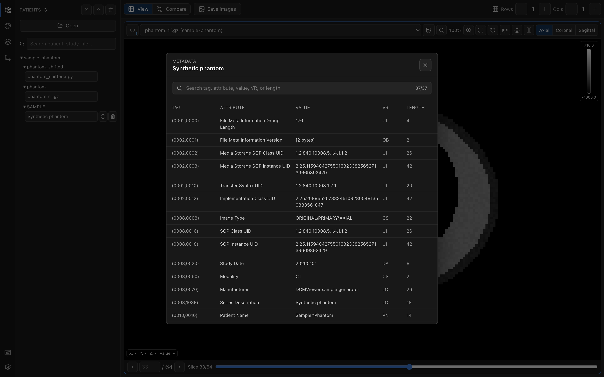
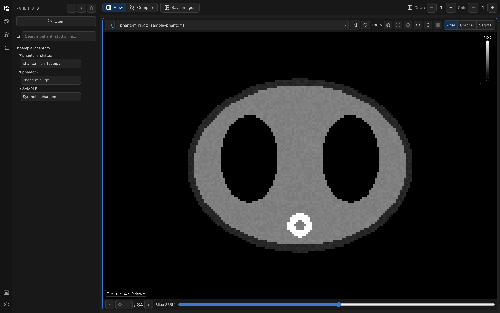
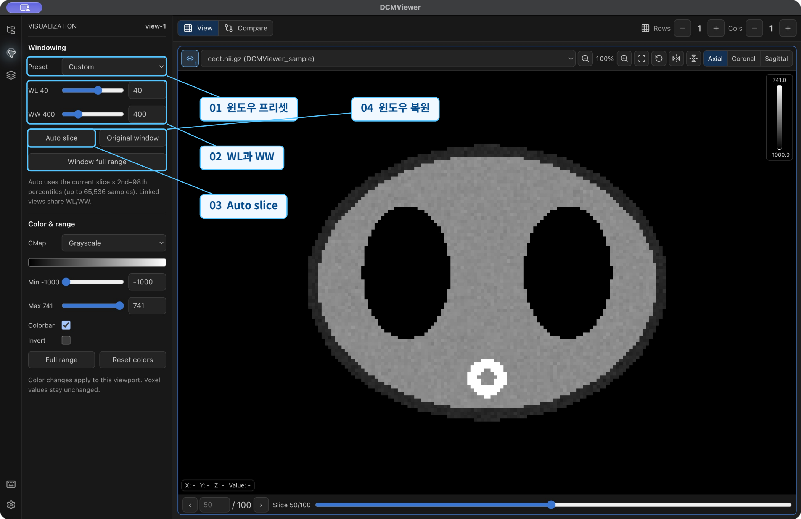
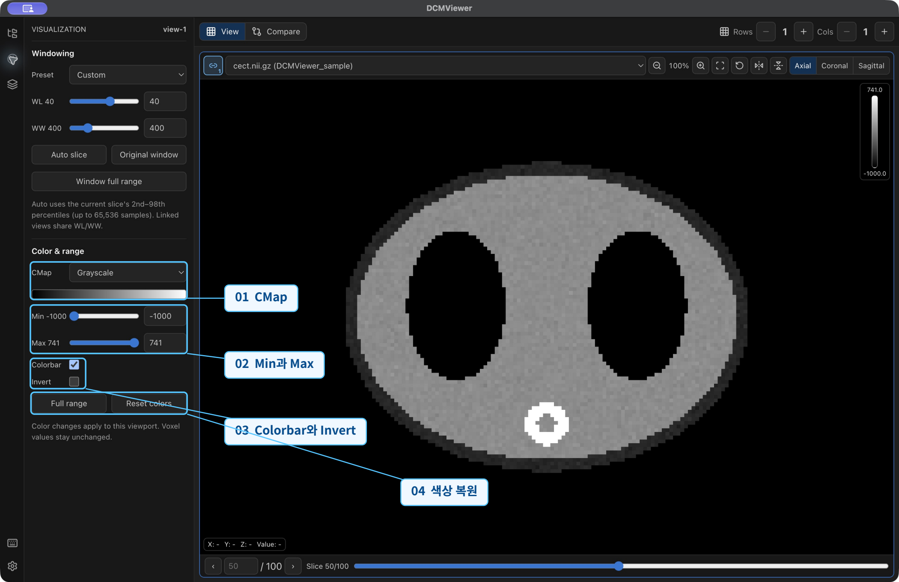
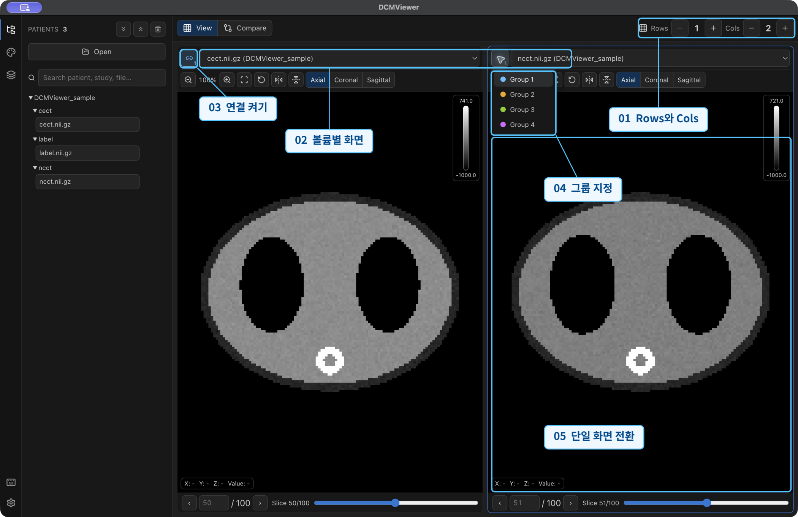
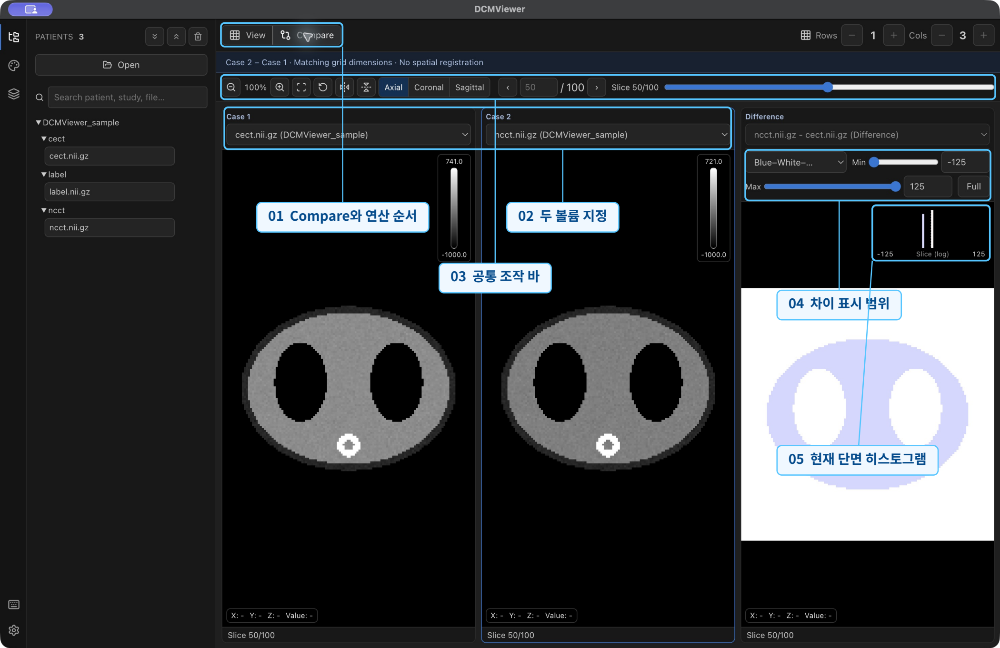
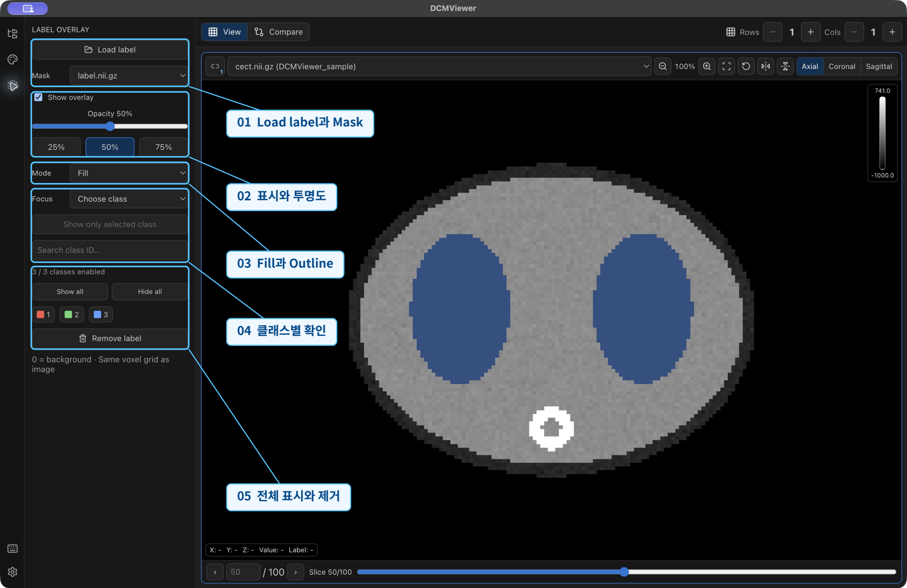
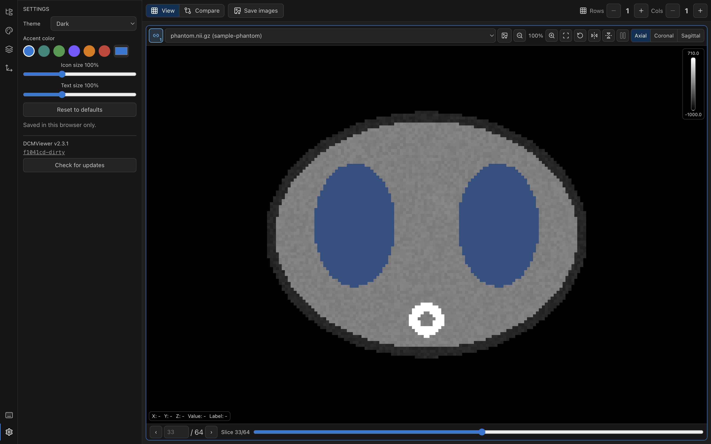
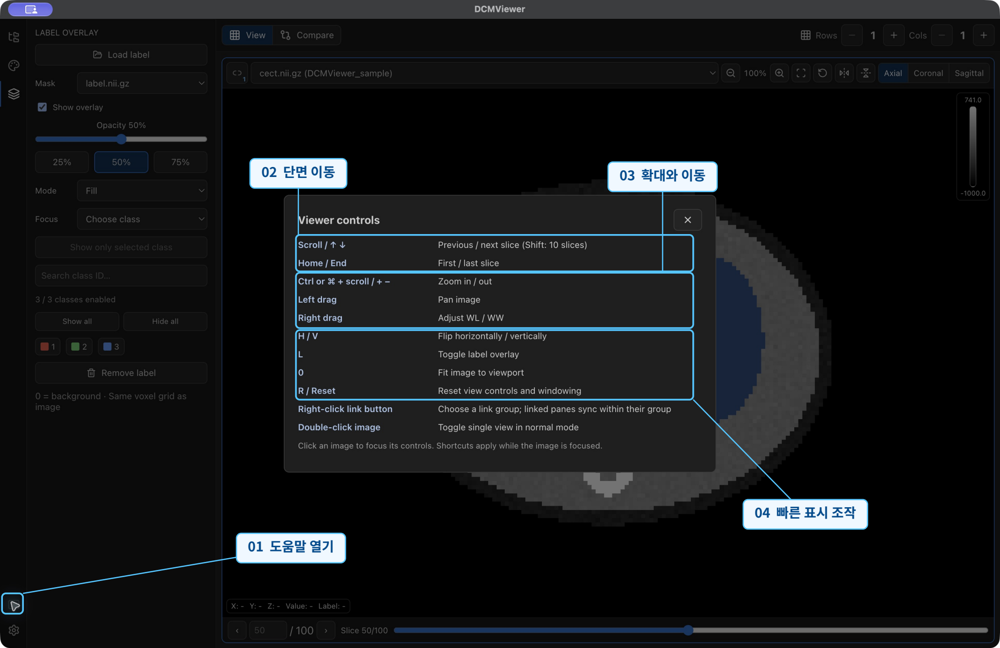

# DCMViewer 기능 설명서

DCMViewer 데스크톱 앱에서 영상을 열고 탐색하며, 표시 설정, 멀티뷰, 비교, 라벨 오버레이와 DICOM 메타데이터 기능을 사용하는 방법을 설명합니다. 실제 실행 화면 위의 번호와 기능명을 아래 설명과 함께 확인하세요.

- **실행 환경:** macOS 데스크톱 앱
- **기준 버전:** 2.1.2
- **빌드 커밋:** [`4edaa83`](https://github.com/qqaazz0222/DCMViewer/commit/4edaa83)
- **화면 캡처일:** 2026년 10월 16일
- **예시 데이터:** `DCMViewer_sample` 및 `Synthetic phantom` 샘플 영상과 마스크

## 목차

- [1. 화면 구성 살펴보기](#overview)
- [2. 파일을 열고 원하는 볼륨 찾기](#open-volumes)
- [3. DICOM 메타데이터 확인하기](#dicom-metadata)
- [4. 단면과 화면 크기 조절하기](#navigation)
- [5. 밝기와 대비 조절하기](#windowing)
- [6. 컬러맵과 표시 범위 정하기](#color-range)
- [7. 여러 화면을 배치하고 연결하기](#multiview)
- [8. 두 영상과 차이 영상 비교하기](#compare)
- [9. 라벨 마스크를 영상 위에 표시하기](#label-overlay)
- [10. 화면 설정과 앱 정보 확인하기](#settings)
- [11. 마우스와 키보드 조작 익히기](#controls)
- [지원 형식과 제한](#supported-formats)
- [문제 해결](#troubleshooting)
- [문서 범위와 참고 자료](#references)

## 빠른 시작

1. **Patients → Open**에서 영상 파일 또는 폴더를 선택합니다.
2. 목록에서 볼륨을 선택하고 영상 영역을 클릭해 조작 대상을 정합니다.
3. **Axial / Coronal / Sagittal**과 하단 단면 번호 또는 슬라이더로 원하는 단면을 찾습니다.
4. **Visualization**에서 WL, WW, 컬러맵과 표시 범위를 조절합니다.
5. 필요에 따라 **Compare**로 두 영상을 비교하거나 **Label Overlay → Load label**로 마스크를 겹칩니다.

## 1. 화면 구성 살펴보기

실제 실행 화면으로 익히는 데스크톱 앱 사용법

*macOS 데스크톱 앱 2.1.2 · 빌드 4edaa83 · 2026년 10월 16일 캡처*

### 01. 패널 전환

왼쪽 아이콘으로 Patients, Visualization, Label Overlay를 선택합니다. 선택된 아이콘을 다시 누르면 패널을 접습니다.

### 02. 영상 불러오기

Patients의 Open에서 영상 파일 또는 폴더를 선택합니다. 이 설명서는 이미 열린 샘플 볼륨을 사용합니다.

### 03. 화면 구성

View에서 여러 뷰포트를 배치하고, Compare에서 두 영상과 차이 영상을 함께 확인합니다.

### 04. 활성 뷰포트

영상 영역을 클릭해 조작 대상을 선택합니다. 테두리와 표시 패널의 view 번호로 대상을 확인합니다.

**사용 팁:** 사용 순서  Open → 볼륨 선택 → 단면 이동 → 표시 조절 → 비교 또는 라벨 확인

## 2. 파일을 열고 원하는 볼륨 찾기

Patients 패널

*예시 볼륨  cect.nii.gz · ncct.nii.gz · label.nii.gz*

### 01. Open

파일 또는 폴더를 선택합니다. DICOM 전체 시리즈는 해당 시리즈가 들어 있는 폴더로 불러옵니다.

### 02. 검색

환자, Study, Series 또는 파일 이름으로 목록을 좁힙니다. 검색 결과에서 원하는 볼륨을 선택합니다.

### 03. 폴더와 볼륨

삼각형으로 폴더를 펼치고 파일 이름을 클릭합니다. 선택한 볼륨은 활성 뷰포트에 표시됩니다.

### 04. 펼치기와 제거

상단 아이콘은 전체 펼치기, 전체 접기, 전체 제거입니다. 제거는 뷰어 목록에서 빼는 동작입니다.

### 05. 뷰포트의 영상 선택

각 뷰포트 상단의 목록에서 표시할 볼륨을 바꿉니다. 멀티뷰에서는 화면마다 다른 볼륨을 선택할 수 있습니다.

**사용 팁:** 파일이 일부 열리지 않으면 로딩 오류의 Details를 확인하고 지원 형식을 점검합니다.

## 3. DICOM 메타데이터 확인하기

Patients의 View metadata

*합성 DICOM 샘플의 실제 메타데이터 화면 · 전체 37개 항목*

### 01. 메타데이터 열기

DICOM 볼륨 옆의 정보 버튼을 누르면 Metadata 창이 열립니다. 상단에서 조회 중인 볼륨 이름을 확인합니다.

### 02. 태그 검색

검색창에 태그 번호, 속성 이름 또는 값을 입력해 목록을 좁힙니다. VR과 Length로도 검색할 수 있습니다.

### 03. 검색 결과 수

검색창 오른쪽의 숫자는 표시된 항목 수와 전체 항목 수입니다. 검색어를 지우면 전체 목록으로 돌아갑니다.

### 04. 태그와 값 읽기

TAG는 태그 번호, ATTRIBUTE는 속성 이름, VALUE는 값입니다. VR은 값의 표현 형식, LENGTH는 데이터 길이를 보여줍니다.

### 05. 영상으로 돌아가기

오른쪽 위 닫기 버튼 또는 Escape로 Metadata 창을 닫고 영상 탐색으로 돌아갑니다.

**사용 팁:** 예시는 Synthetic phantom DICOM 시리즈입니다. 파일 목록의 영상 선택과 메타데이터 열기는 서로 다른 버튼입니다.

## 4. 단면과 화면 크기 조절하기

영상 뷰포트

*캡처 상태  Axial · 50번째 단면 · 전체 100장 · 확대율 100%*

### 01. 축 선택

Axial은 축상면, Coronal은 관상면, Sagittal은 시상면입니다. 축을 바꾸면 해당 방향의 단면을 표시합니다.

### 02. 확대와 맞춤

돋보기 −와 +로 확대율을 조절합니다. Fit image 또는 0은 화면 맞춤, Reset 또는 R은 표시 설정을 초기화합니다.

### 03. 좌우와 상하 반전

두 플립 버튼 또는 H와 V로 표시 방향을 바꿉니다. 원본 복셀 데이터는 바꾸지 않습니다.

### 04. 단면 번호와 슬라이더

하단 번호를 입력하고 Enter로 이동합니다. 슬라이더, 양쪽 화살표, 마우스 휠로도 단면을 바꿉니다.

### 05. 좌표와 값

영상 위에 포인터를 두면 X, Y, Z와 Value가 표시됩니다. 활성 라벨이 있으면 Label 값도 함께 확인할 수 있습니다.

**사용 팁:** 마우스 왼쪽 드래그는 영상 이동, 오른쪽 드래그는 WL과 WW 조절입니다. 단축키는 영상에 포커스를 둡니다.

## 5. 밝기와 대비 조절하기

Visualization의 Windowing

*WL과 WW는 표시 방식이며 원본 영상의 복셀 값은 유지됩니다.*

### 01. 윈도우 프리셋

Preset에서 Brain, Lung, Bone 등 용도에 맞는 윈도우를 선택합니다. 이후 WL과 WW를 직접 조절할 수 있습니다.

### 02. WL과 WW

WL은 표시 범위의 중심, WW는 폭입니다. 슬라이더 또는 숫자 입력으로 조절해 관찰할 값 범위를 정합니다.

### 03. Auto slice

현재 단면의 값 분포를 이용해 윈도우를 정합니다. 축이나 단면을 바꾼 뒤에도 필요한 위치에서 다시 적용할 수 있습니다.

### 04. 윈도우 복원

Original window는 로딩 당시의 WL과 WW를 복원합니다. Window full range는 볼륨 전체 값 범위를 사용합니다.

**사용 팁:** 먼저 조절할 영상 영역을 클릭합니다. 연결된 뷰포트끼리는 WL과 WW 변경이 함께 적용됩니다.

## 6. 컬러맵과 표시 범위 정하기

Visualization의 Color & range

*일반 영상의 컬러맵 변경은 복셀 값이나 라벨 클래스 색상을 바꾸지 않습니다.*

### 01. CMap

Grayscale, Viridis, Hot 등 컬러맵을 선택합니다. 아래 미리보기와 영상 오른쪽 컬러바로 색상 척도를 확인합니다.

### 02. Min과 Max

표시할 값의 하한과 상한을 조절합니다. 이 클리핑 범위는 Windowing과 별도로 유지됩니다.

### 03. Colorbar와 Invert

Colorbar로 영상 옆 척도를 표시하거나 숨깁니다. Invert는 선택한 컬러맵의 진행 방향을 반전합니다.

### 04. 색상 복원

Full range는 클리핑을 전체 값 범위로 되돌립니다. Reset colors는 흑백, 반전 해제, 전체 범위와 컬러바를 복원합니다.

**사용 팁:** 색상 설정은 뷰포트별로 적용됩니다. 비교 모드의 Difference에는 해당 패널의 별도 색상과 범위 조절을 사용합니다.

## 7. 여러 화면을 배치하고 연결하기

View 모드의 멀티뷰

*그룹 메뉴를 펼친 실제 실행 화면 · Group 1 연결 예시*

### 01. Rows와 Cols

행과 열의 −와 +로 뷰 개수를 정합니다. 일반 모드는 최대 4행 4열이며, 예시는 1행 2열입니다.

### 02. 볼륨별 화면

각 화면 상단에서 볼륨을 선택합니다. 예시는 왼쪽 cect, 오른쪽 ncct로 두 영상을 나란히 배치한 상태입니다.

### 03. 연결 켜기

양쪽 뷰포트의 체인 버튼을 켭니다. 같은 그룹에 연결된 화면끼리 축, 단면, WL과 WW, 플립을 공유합니다.

### 04. 그룹 지정

체인 버튼을 우클릭하면 Group 1부터 4까지 선택할 수 있습니다. 그룹을 고르면 연결이 켜집니다.

### 05. 단일 화면 전환

일반 모드의 영상 영역을 더블클릭하면 해당 화면을 크게 볼 수 있습니다. 다시 더블클릭하면 그리드로 돌아옵니다.

**사용 팁:** 일반 멀티뷰의 확대와 이동은 화면별로 조절합니다. 단면 수가 다른 영상은 같은 상대 위치의 단면으로 연결됩니다.

## 8. 두 영상과 차이 영상 비교하기

Compare 모드

*실제 비교 화면 · Case 1 cect · Case 2 ncct · Difference ncct − cect*

### 01. Compare와 연산 순서

Compare를 선택하면 Case 1, Case 2, Difference가 나타납니다. 차이는 Case 2에서 Case 1을 뺀 값입니다.

### 02. 두 볼륨 지정

Case 1과 Case 2의 목록에서 서로 다른 볼륨을 선택합니다. 예시의 차이는 ncct − cect입니다.

### 03. 공통 조작 바

상단의 확대, 맞춤, 초기화, 플립, 축, 단면을 세 화면에 함께 적용합니다. 영상 이동도 비교 화면 사이에 동기화됩니다.

### 04. 차이 표시 범위

Difference 패널에서 컬러맵과 Min, Max를 정합니다. Full로 전체 차이 범위를 복원할 수 있습니다.

### 05. 현재 단면 히스토그램

Difference 오른쪽 그래프는 현재 단면 값의 분포를 로그 척도로 보여줍니다. 표시 범위와 함께 확인합니다.

**사용 팁:** 차이 계산은 두 볼륨의 가로와 세로 크기가 같아야 합니다. 자동 공간 정합을 하지 않으므로 같은 격자인지 먼저 확인합니다.

## 9. 라벨 마스크를 영상 위에 표시하기

Label Overlay 패널

*실제 예시  label.nii.gz · Fill · Opacity 50% · 클래스 3의 파란 영역 표시*

### 01. Load label과 Mask

대상 영상 영역을 선택한 뒤 Load label로 마스크를 불러옵니다. 여러 마스크를 열었으면 Mask에서 하나를 선택합니다.

### 02. 표시와 투명도

Show overlay로 표시를 전환합니다. Opacity 슬라이더 또는 25%, 50%, 75% 버튼으로 원본 영상과 겹치는 정도를 정합니다.

### 03. Fill과 Outline

Mode에서 영역을 채우는 Fill 또는 경계선을 표시하는 Outline을 고릅니다.

### 04. 클래스별 확인

Focus에서 클래스를 고른 뒤 Show only selected class로 하나만 표시합니다. 검색은 클래스 목록을 좁히는 기능입니다.

### 05. 전체 표시와 제거

클래스 버튼으로 각각 켜고 끄며 Show all로 복원합니다. Remove label은 불러온 오버레이를 제거합니다.

**사용 팁:** 라벨 0은 배경입니다. 영상과 마스크의 크기, 축 순서, 복셀 간격, 공간 방향은 같은 격자로 맞춰야 합니다.

## 10. 화면 설정과 앱 정보 확인하기

Settings 패널

*설정 화면 캡처 시점의 값  Dark · Blue · 아이콘 100% · 텍스트 100%*

### 01. Theme

Dark, Light 또는 System을 선택합니다. System은 운영체제의 화면 모드를 따릅니다.

### 02. Accent color

색상 프리셋 또는 직접 선택으로 강조 색을 정합니다. 버튼 선택 상태와 활성 화면 표시에 반영됩니다.

### 03. 아이콘과 글자 크기

Icon size와 Text size를 조절해 가독성을 맞춥니다. Reset to defaults는 화면 설정을 기본값으로 되돌립니다.

### 04. 버전과 업데이트

패널 하단에서 실행 버전과 빌드 커밋을 확인합니다. Check for updates로 최신 릴리스를 조회합니다.

**사용 팁:** 캡처한 앱은 DCMViewer v2.1.2, 빌드 4edaa83입니다. 화면 설정은 현재 앱 환경에 저장됩니다.

## 11. 마우스와 키보드 조작 익히기

Controls 도움말

*앱에 내장된 Viewer controls를 실제로 연 화면*

### 01. 도움말 열기

왼쪽 아래 키보드 아이콘을 누르면 Viewer controls가 열립니다. 닫기 버튼으로 영상으로 돌아갑니다.

### 02. 단면 이동

휠 또는 ↑와 ↓는 한 장씩, Shift와 방향키는 10장씩 이동합니다. Home과 End는 처음과 끝으로 이동합니다.

### 03. 확대와 이동

Ctrl 또는 ⌘와 휠, +와 −로 확대율을 바꿉니다. 왼쪽 드래그로 이동하고 오른쪽 드래그로 WL과 WW를 조절합니다.

### 04. 빠른 표시 조작

H와 V는 플립, L은 라벨 전환, 0은 맞춤, R은 표시 설정과 윈도우 초기화입니다.

**사용 팁:** 영상 영역을 클릭해 포커스를 둔 뒤 사용합니다. 검색창이나 숫자 입력란에 입력 중일 때는 영상 단축키가 적용되지 않습니다.

### 주요 조작 빠르게 보기

| 조작 | 동작 |
| --- | --- |
| 마우스 휠 또는 `↑` / `↓` | 이전 또는 다음 단면 |
| `Shift` + 방향키 | 단면 10장씩 이동 |
| `Home` / `End` | 첫 단면 또는 마지막 단면 |
| 하단 단면 번호 입력 + `Enter` | 지정한 단면으로 이동 |
| `Ctrl` 또는 `⌘` + 휠, `+` / `−` | 확대 또는 축소 |
| 마우스 왼쪽 드래그 | 영상 이동 |
| 마우스 오른쪽 드래그 | WL / WW 조절 |
| `H` / `V` | 좌우 또는 상하 플립 |
| `L` | 라벨 오버레이 표시 전환 |
| `0` | 화면에 맞춤 |
| `R` | 표시 설정과 윈도우 초기화 |
| 체인 버튼 우클릭 | 연결 그룹 선택 |
| 영상 더블클릭 | 일반 모드에서 단일 화면과 그리드 전환 |

## 지원 형식과 제한

| 형식 | 지원 내용 | 주요 제한 |
| --- | --- | --- |
| DICOM | `.dcm`, `.dicom`, 비압축 단일 채널 8/16-bit 데이터. 전체 시리즈는 폴더로 선택합니다. | 압축 픽셀 데이터는 지원하지 않습니다. |
| NIfTI | `.nii`, `.nii.gz`, 공간의 세 축 표시 | 시간축과 고차원 채널 탐색은 지원하지 않습니다. |
| NumPy | `.npy`, `.npz` (배열마다 별도 볼륨) C-order 숫자 배열. 2D, 3D 및 채널이 앞에 오는 4D 배열 | Fortran-order는 지원하지 않습니다. |

## 문제 해결

### 차이 영상이 나타나지 않음

Case 1과 Case 2가 서로 다른 볼륨인지, 두 볼륨의 가로와 세로 크기가 같은지 확인합니다. 크기가 달라도 두 원본 영상은 나란히 볼 수 있습니다.

### 라벨이 보이지 않음

대상 볼륨, Mask 선택, Show overlay, 투명도, 클래스 표시 상태와 현재 단면을 확인합니다. 영상과 마스크의 크기 및 공간 격자가 일치해야 합니다.

### 밝기 조절이 예상과 다름

활성 뷰포트와 연결 그룹을 확인합니다. Original window 또는 Reset을 사용하고, Color & range의 Min과 Max도 확인합니다.

### 파일 로딩에 실패함

오류의 Details와 지원 형식 제한을 확인합니다. 압축 DICOM, Fortran-order NPY 또는 지원하지 않는 차원인지 점검합니다.

## 문서 범위와 참고 자료

이 문서는 실행 중인 macOS 데스크톱 앱 2.1.2의 기능을 다룹니다. 웹 관리자 기능과 VS Code 원격 연결 절차는 포함하지 않습니다. 캡처한 샘플 영상과 마스크는 기능 설명용이며, 표시된 클래스 ID에 임상 의미를 부여하지 않습니다.

사용 방법은 실제 실행 화면을 기준으로 작성하고 저장소 설명과 구현을 함께 확인했습니다. 버전에 따라 화면 배치나 동작이 달라질 수 있습니다.

- [DCMViewer 저장소 및 README](https://github.com/qqaazz0222/DCMViewer)
- [화면 구성과 패널 구현 App.tsx](https://github.com/qqaazz0222/DCMViewer/blob/4edaa83/src/App.tsx)
- [화면 조작과 동기화 구현 viewport.ts](https://github.com/qqaazz0222/DCMViewer/blob/4edaa83/src/viewport.ts)
- [영상 뷰포트 구현 SliceViewport.tsx](https://github.com/qqaazz0222/DCMViewer/blob/4edaa83/src/components/SliceViewport.tsx)
